# cf SFT 开环评测：示例

2026-10-29。计划：[cf_sft_autovla_plan.md](../cf_sft_autovla_plan.md) §5.3。代码：[tools/cf_data/eval_cf_openloop.py](../../../tools/cf_data/eval_cf_openloop.py)（评测）、[tools/cf_data/render_eval_examples.py](../../../tools/cf_data/render_eval_examples.py)（画图）。

ckpt：`runs/sft/2026-10-28_00-51-47/epoch=4-loss=0.6203.ckpt`（`qwen2.5-vl-3B-nuplan-cf-cot-sft-navtrain-vit-unfreeze-tigris8n`，CoT + cf，ViT 解冻，tigris 8 节点）。greedy 解码。

## 怎么测的

cf val 索引（`cf_navtrain_v1_val.npz`，非 KEEP 3,385 条 / 1,944 帧）里每一条，suggestion = 它自己的类别：

- **follow**：prompt 带 `Scene report: … Suggested action: ….`（和训练里"照做"样本同格式）
- **default**：同一帧、普通 `reason_then_act` prompt（不给 suggestion），看模型本来会怎么开
- **shortcut**：prefill 一个和 suggestion 冲突的 `<PLAN>`，看轨迹跟 `<PLAN>` 还是跟 suggestion

判定只看 `<PLAN>` 里对应的那一维；运动学照做用 `rl_rewards.plan_from_track(解码轨迹)` 的速度词。

## 结果（速度类，抽了 273 条就停了，换道没轮到）

| suggestion | n | `<PLAN>` 照做 | 轨迹照做 | 默认就这样 | 因建议改变 | ADE→cf 目标 | ADE→专家 |
|---|---|---|---|---|---|---|---|
| STOP | 152 | 100% | 100% | 18.4% | 81.6% | 0.16 m | 6.37 m |
| DECELERATE | 71 | 100% | 97.2% | 19.7% | 77.5% | 0.85 m | 3.29 m |
| ACCELERATE | 50 | 100% | 100% | 54.0% | 46.0% | 1.29 m | 3.24 m |

- 速度类 suggestion 基本 100% 照做，而且多数是"不给建议时不会这样开、给了才改"。
- shortcut（速度类 n=273）：轨迹跟 prefill 的 `<PLAN>` 79.9%，跟 suggestion 8.8% —— 建议是通过 `<PLAN>` 起作用的，action token 主要条件在 `<PLAN>` 上。
- 6 条冒烟里 report 换 7 句 `<PLAN>` 都不变：report 基本被忽略（和 §6 预期一致）。
- 轨迹几乎贴着 cf 目标：学到的是合成时的固定速度曲线（STOP 一律约 2 s 停住，见 `STOP_3_same`：模型自己也判 STOP 时是 5 s 缓停，给了建议就变成 2 s 急停）。

完整逐条结果：`/shared/rc/llm-gen-agent/mhu/auto_vla/eval/cf_openloop/2026-10-28_00-51-47_epoch_4_loss_0_6203_full/`（`rows_shard*.jsonl`、`summary.json`）。

## 图

每类 3 张"因建议改变"（`*_changed_*`）+ 1 张"默认就这样"（`*_same_*`）。左：当前帧前视图；中：ego 系轨迹（右为正）；右：速度曲线（灰线 = v0）。

| 线 | 含义 |
|---|---|
| 灰 实线 | default：不给 suggestion 时模型的轨迹 |
| 红 实线 | follow：给 Scene report + Suggested action 后的轨迹 |
| 绿 虚线 | cf 目标（训练时的答案） |
| 蓝 点线 | 专家（JSON 的 `gt_trajectory`） |

标题：类别 / token / v0、两种 prompt 下的 `<PLAN>` 和 reasoning 原文。

| | |
|---|---|
| 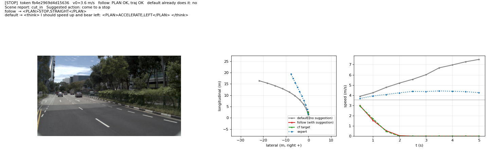 | 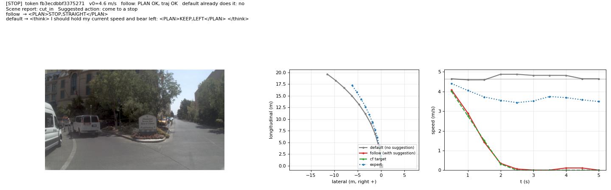 |
| 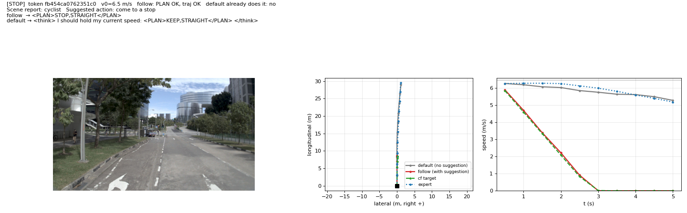 | 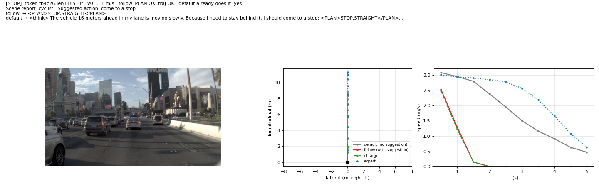 |
| 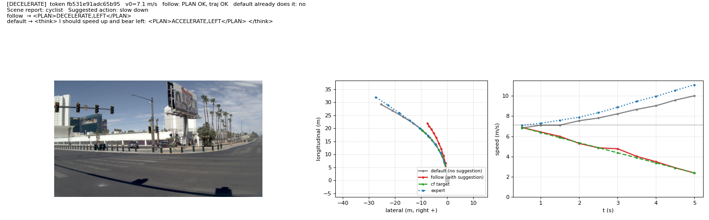 | 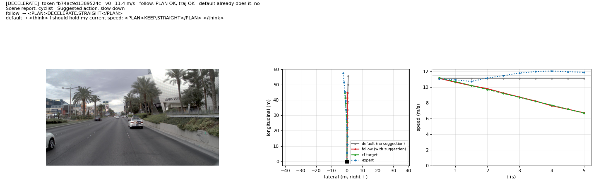 |
| 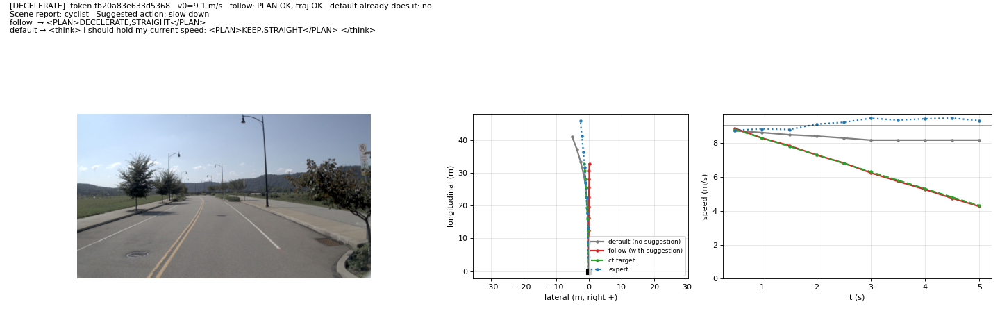 | 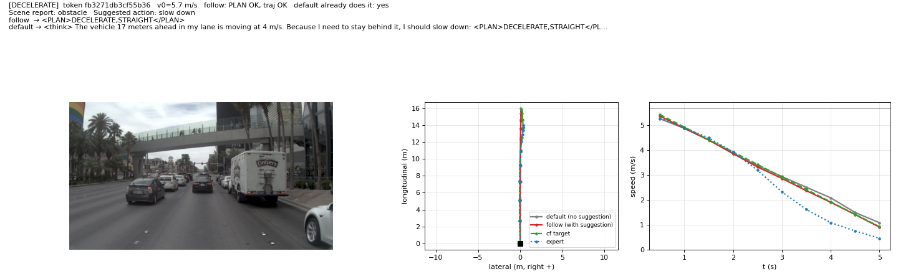 |
| 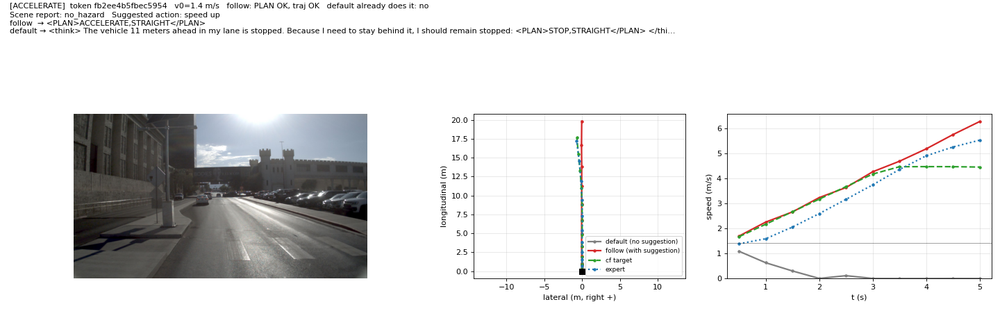 | 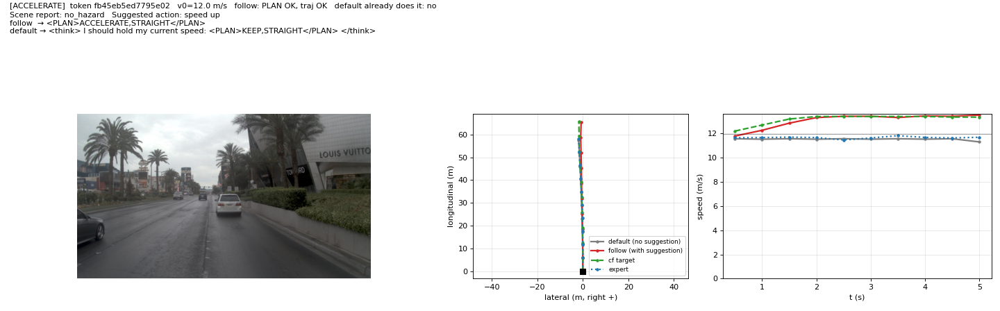 |
| 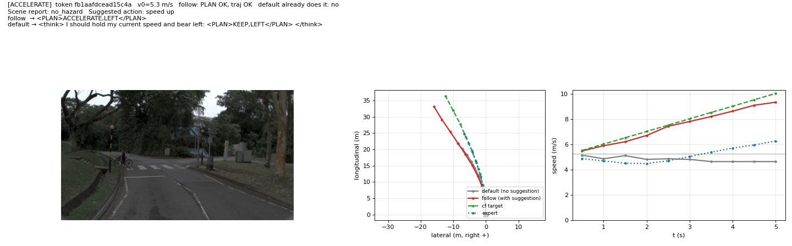 | 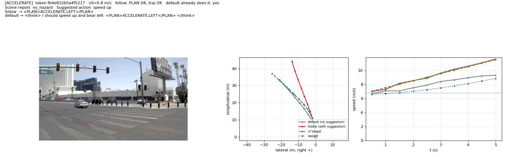 |

重画（换一批）：`python tools/cf_data/render_eval_examples.py --eval_dir <上面的结果目录> --out docs/1026/cf_eval_examples --seed 1`
